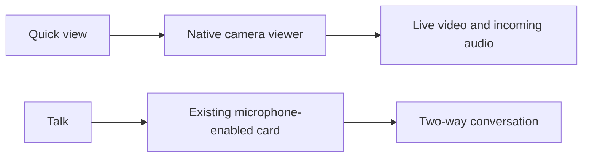

# Fermax Blue – Quick Preview installation guide

An experimental fork of [bvis/fermax-blue-hass](https://github.com/bvis/fermax-blue-hass), based on [v1.0.0](https://github.com/bvis/fermax-blue-hass/tree/v1.0.0).

## Changes

- Camera controls and the WebRTC viewer share an in-progress wake request to avoid conflicting requests.
- During a manual preview, the viewer can receive H.264 video while Fermax finishes accepting the session. Incoming audio connects in the background.
- The manual-preview video receiver uses the ICE candidates announced by Fermax without querying aiortc’s default STUN server. The call flow, audio transports and viewer-side ICE configuration keep their upstream settings.

This configuration was tested with a Fermax VEO WiFi. The native Home Assistant camera viewer showed movement after about **4 seconds** on a PC and on a phone using mobile data when opened from the device page. The embedded dashboard viewer took about **8 seconds** after the accumulated changes. These are observations from one installation. The viewer, network and starting state affect the result.

## Install this branch manually

1. Back up your current `custom_components/fermax_blue` directory.
2. Open the [`quick-preview-v1.0.0` branch](https://github.com/matexdj/fermax-blue-quick-preview/tree/quick-preview-v1.0.0), then choose **Code → Download ZIP** and extract it. The changes are already included in this branch.
3. Copy the resulting `custom_components/fermax_blue` directory from the extracted ZIP into your Home Assistant configuration directory. Keep your existing integration entry.
4. Restart Home Assistant. From idle, check live video and audio, then try again over mobile data if you use remote access. Ring the physical doorbell and check the notification, conversation, door release and recording playback.

If the preview fails to connect on your network, restore the backup. If the first preview after a restart stalls, wait for Home Assistant and the integration to finish starting before retrying.

## Quick view in Dwains Dashboard

Add a button that opens the native camera viewer. Replace the example entity ID with your Fermax camera entity.

```yaml
type: button
name: Quick view
icon: mdi:cctv
entity: camera.example_visitor
tap_action:
  action: more-info
```



Opening the viewer can wake the camera. For two-way talk, use your existing conversation card. The dashboard button is configured separately in Home Assistant.

## Rollback and updates

Restore your backed-up integration directory and restart Home Assistant. Keep your existing Home Assistant configuration entry. Never include credentials, tokens, or private recordings in a public issue. HACS can overwrite locally patched files when it updates the integration. To move to another upstream version, review and test the patch against that version before replacing the installed files.

## Credits and license

Original integration by **bvis** and its contributors. Distributed under the [MIT License](LICENSE). Keep the original copyright and license notices when redistributing the code.
